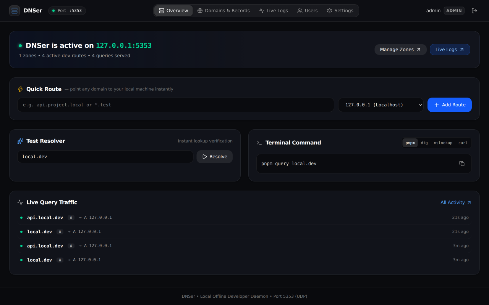

<div align="center">
  
  <h1>DNSer</h1>
  <p><strong>Offline-First Developer DNS Daemon & Human-Crafted Control Dashboard</strong></p>
  <p>A zero-friction, lightweight DNS server designed specifically for local web development, microservices, container routing, and staging environments.</p>

  <p>
    <a href="#-quick-start">Quick Start</a> •
    <a href="#-dashboard-preview">Preview</a> •
    <a href="#-key-features">Features</a> •
    <a href="#-testing-dns-resolution">Testing DNS</a> •
    <a href="#-test-suites">Test Suites</a> •
    <a href="#-architecture">Architecture</a>
  </p>
</div>

---

## 🖥️ Dashboard Preview

<div align="center">
  
  <p><em>DNSer real-time dashboard with Quick Route bar, interactive DNS resolver, and live query traffic feed.</em></p>
</div>

---

## 🎬 10-Second Demo

Watch DNSer in action with clean logs and real-time DNS resolution:

<div align="center">
  <video src="docs/demo.mp4" controls width="100%" style="max-width: 900px; border-radius: 10px; box-shadow: 0 16px 36px rgba(0,0,0,0.4);" poster="docs/dashboard.png">
    Your browser does not support the video tag. View the demo video file directly at <a href="docs/demo.mp4"><code>docs/demo.mp4</code></a>.
  </video>
  <p><em>Direct video file: <a href="docs/demo.mp4"><code>docs/demo.mp4</code></a></em></p>
</div>

---

## ⚡ Key Features

- **Embedded UDP DNS Daemon**: RFC 1035 compliant DNS engine running directly in Node.js via `dgram` and `dns-packet`.
- **Offline First**: Instant sub-millisecond local record resolution without requiring an external internet connection.
- **Human-Crafted Apple Design**: Restrained, quiet visual hierarchy built using Apple interface principles — glass finishes, monospace tabular alignment, and fluid micro-interactions.
- **Instant Quick Route Bar**: Map any domain (e.g. `backend.local.dev` or `*.project.test`) to localhost (`127.0.0.1`) or your machine's LAN IP with a single keypress.
- **Interactive Resolver Widget**: Test host resolutions directly inside the web UI without leaving the browser.
- **1-Click NXDOMAIN Recovery**: Unresolved DNS queries in the live stream display a `+ Route to 127.0.0.1` button to immediately fix local routing misses.
- **Wildcards & Record Types**: Native support for `A`, `AAAA`, `CNAME`, `TXT`, `MX`, and wildcard patterns (`*.local.dev`).
- **Optional Upstream Relay**: Seamlessly forwards unknown lookups to upstream providers (`1.1.1.1` or `8.8.8.8`) with a toggle switch.
- **Live Query Streaming (SSE)**: Real-time query feed showing client IPs, query types, response status (`NOERROR`, `NXDOMAIN`), and sub-millisecond resolution timings.
- **Role-Based Access Control (RBAC)**: Secure token authentication with three user tiers:
  - `Admin`: Full control over users, zones, records, and engine settings.
  - `Developer`: Domain and route configuration, live logs stream.
  - `Viewer`: Read-only access to records and query metrics.
- **No `dig` or `nslookup` Required**: Includes a standalone built-in CLI query utility: `pnpm query <domain>`.
- **Zero Heavy Databases**: Powered by Node.js v24 native `node:sqlite` (`DatabaseSync`), requiring zero external database installations or native C++ compilation bindings.

---

## 🚀 Quick Start

### 1. Prerequisites
- **Node.js**: v22.12.0+ (Node.js v24 recommended for native `node:sqlite`)
- **pnpm**: v9+ (or `npm`)

### 2. Installation
```bash
git clone git@github.com:ilay515/DNSer.git
cd DNSer
pnpm install
```

### 3. Run Development Mode
Starts both the Fastify API / UDP DNS daemon (:3000 / :5353) and the Vite frontend (:5173) concurrently:
```bash
pnpm dev
```
- **Web Dashboard**: [http://localhost:5173](http://localhost:5173)
- **Backend API**: [http://localhost:3000](http://localhost:3000)
- **DNS Daemon**: `udp://127.0.0.1:5353`

### 4. Production Build & Run
```bash
pnpm build
pnpm start
```

---

## 🔑 Default Credentials

| Username | Password | Role |
| :--- | :--- | :--- |
| `admin` | `admin123` | `Admin` |

*(Credentials can be updated or new developer accounts added directly in the **Users** tab).*

---

## 🧪 Testing DNS Resolution

DNSer includes a built-in resolver tool so you don't need `dig` or `nslookup` installed on your machine:

```bash
# Query a local domain
pnpm query local.dev

# Query any wildcard subdomain
pnpm query api.local.dev

# Query a custom type or port
pnpm query local.dev --type A --port 5353
```

You can also use standard system tools:
```bash
# Using dig
dig @127.0.0.1 -p 5353 local.dev

# Using curl over DNS
curl --dns-servers 127.0.0.1:5353 http://local.dev:3000
```

---

## 🔬 Test Suites

DNSer maintains a comprehensive automated test suite with 100% test pass rate across engine and REST interfaces:

```bash
# Run all test suites
pnpm test

# Run DNS engine resolution tests
pnpm test:dns

# Run REST API, RBAC, and Authentication tests
pnpm test:api
```

### Coverage Overview:
- **`test/dns.test.ts`**:
  - RFC 1035 UDP packet decoding and response encoding
  - Exact match (`local.dev`), case-insensitivity (`LoCaL.DeV.`), and trailing dots
  - Wildcard subdomain synthesis (`*.local.dev` -> `auth.local.dev`)
  - AAAA (IPv6), TXT, MX (priority), and CNAME alias resolution
  - Active toggle states (`is_active: 0` suppression)
  - Cascade deletion integrity on zones and associated records
  - Ring-buffer in-memory query logging
- **`test/api.test.ts`**:
  - Scrypt password hashing & secure session tokens
  - Authentication middleware (`401 Unauthorized` checks)
  - RBAC enforcement (Developer vs Admin permission gating)
  - Domain validation and duplicate zone rejection
  - DNS record creation, payload validation, and inline updates
  - Settings persistence & live statistics aggregation

---

## 🏗️ Architecture

```
                       ┌─────────────────────────────────────────┐
                       │          DNSer Core Process             │
                       │                                         │
┌────────────────┐     │  ┌─────────────────┐ ┌───────────────┐  │
│  UDP Clients   │────►│  │ UDP DNS Engine  │ │  Fastify API  │  │
│ (System/Apps)  │     │  │   (Port 5353)   │ │  (Port 3000)  │  │
└────────────────┘     │  └────────┬────────┘ └───────┬───────┘  │
                       │           │                  │          │
                       │           ▼                  ▼          │
                       │    ┌─────────────────────────────┐      │
                       │    │    SQLite (node:sqlite)     │      │
                       │    │   Zones, Records, Users     │      │
                       │    └─────────────────────────────┘      │
                       │                  ▲                      │
                       │                  │ SSE Live Queries     │
                       └──────────────────┼──────────────────────┘
                                          │
                                          ▼
                                ┌───────────────────┐
                                │ Vite + React 19   │
                                │  Apple-Craft UI   │
                                └───────────────────┘
```

- **Runtime**: Node.js v24 (Native ESM, TypeScript via `tsx`)
- **DNS Protocol**: `dns-packet` + `node:dgram` UDP socket
- **Database**: `node:sqlite` (`DatabaseSync` embedded storage)
- **API Server**: Fastify v5 with `@fastify/cors` and `@fastify/static`
- **UI Architecture**: React 19, Tailwind CSS v4, Lucide Icons, and Apple Design principles
- **CLI Query Runner**: Node.js UDP client runner

---

## ⚙️ Configuration & System Daemon Setup

### Running on Port 53 (Rootless on Linux)
To bind to port 53 without running as `root`:
```bash
sudo setcap 'cap_net_bind_service=+ep' $(which node)
pnpm start -- --dns-port 53
```

### macOS `/etc/resolver` Setup
Point all `.local.dev` traffic to DNSer on macOS:
```bash
sudo mkdir -p /etc/resolver
sudo tee /etc/resolver/local.dev > /dev/null <<EOF
nameserver 127.0.0.1
port 5353
EOF
```

### Linux `systemd-resolved` Setup
Add to `/etc/systemd/resolved.conf`:
```ini
[Resolve]
DNS=127.0.0.1:5353
Domains=~local.dev
```

---

## 📄 License

MIT © [Ilay](https://github.com/ilay515)
